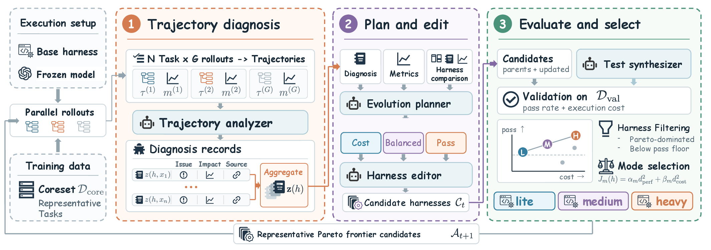

# HarnessPro

[](https://github.com/pzs19/HarnessPro) [](https://pzs19.github.io/HarnessPro/) [](https://arxiv.org/abs/2610.26770) [](#quickstart)

An agent's harness—its instructions, tools, and runtime policies—has a direct
effect on both task performance and execution cost. HarnessPro is a self-supervised
framework that improves this harness recursively. It diagnoses execution traces,
turns their failure and cost patterns into candidate changes, and evaluates those
candidates with synthesized tests rather than ground-truth solutions or official
tests during optimization. Pareto-based selection preserves three useful operating
points: **Lite** for lower cost, **Medium** for balance, and **Heavy** for higher
performance. This release contains the selected harness artifacts for
Terminal-Bench 2, SWE-bench Pro, and ProgramBench.

<p align="center">
  
</p>
<p align="center"><em>HarnessPro's trace-driven evolution and performance–cost selection.</em></p>

## How it works

1. **Diagnose trajectories.** Find failure patterns, redundant tool calls, and avoidable computation across agent rollouts.
2. **Evolve the harness.** Update instructions, execution profiles, tool-use policies, and verification helpers.
3. **Select on both objectives.** Evaluate candidates with synthesized tests and retain representative harnesses along the performance–cost frontier.

## Available harnesses

**Lite** favors lower cost, **Medium** balances performance and cost, and
**Heavy** prioritizes task performance. Choose one mode per agent run.

| Benchmark | Lite | Medium | Heavy |
| :-- | :--: | :--: | :--: |
| Terminal-Bench 2 | [Harness](harnesses/terminal-bench-2/lite/) | [Harness](harnesses/terminal-bench-2/medium/) | [Harness](harnesses/terminal-bench-2/heavy/) |
| SWE-bench Pro | [Harness](harnesses/swe-bench-pro/lite/) | [Harness](harnesses/swe-bench-pro/medium/) | [Harness](harnesses/swe-bench-pro/heavy/) |
| ProgramBench | [Harness](harnesses/programbench/lite/) | [Harness](harnesses/programbench/medium/) | [Harness](harnesses/programbench/heavy/) |

Each harness contains task instructions and a `runtime/` policy with its
associated hooks. Some also include a verification helper or checklist.

<a id="install"></a>

## Quickstart

**Requirements:** Linux, Python 3.12 or 3.13, [uv](https://docs.astral.sh/uv/),
Docker with Compose, and Codex CLI. Our runs used Codex CLI 0.147.0.

```bash
git clone https://github.com/pzs19/HarnessPro.git
cd HarnessPro
uv sync --frozen
uv run python scripts/prepare_runtime.py
```

The preparation script restores executable permissions on the bundled runtime
tools. Download benchmark inputs and configure provider access separately;
see the [setup guide](docs/evaluation.md#setup-and-release-scope).

## Run an evaluation

Set `CODEX_CONFIG` to your Codex Responses-provider TOML and `CODEX_BIN` to the
Codex executable. The examples use Medium mode. For Lite or Heavy, update
`--harness-dir`, `--run-dir`, and `--harness-label` where present.

### Terminal-Bench 2

Set `TB2_TASKS` to the directory containing the benchmark tasks.

```bash
uv run python scripts/run_tb2_harness_eval.py \
  --dataset "$TB2_TASKS" --heldout-ids splits/terminal-bench-2-test.txt \
  --run-dir runs/tb2-medium --harness-label medium \
  --harness-dir harnesses/terminal-bench-2/medium \
  --codex-config "$CODEX_CONFIG" --codex-binary "$CODEX_BIN" \
  --model gpt-5.5 --concurrency 4
```

<details>
<summary><strong>SWE-bench Pro</strong></summary>

Set `SWE_PRO_PARQUET` to the test Parquet. Prepare the exact Go versions
required by the task images using the [toolchain instructions](docs/evaluation.md#swe-bench-pro).

```bash
uv run python scripts/run_swebench_pro_harness_eval.py \
  --dataset "$SWE_PRO_PARQUET" --heldout-ids splits/swe-bench-pro-test.txt \
  --run-dir runs/swe-pro-medium --harness-label medium \
  --harness-dir harnesses/swe-bench-pro/medium \
  --codex-config "$CODEX_CONFIG" --codex-binary "$CODEX_BIN" \
  --docker-command "$(command -v docker)" --cache-root cache/swe-bench-pro \
  --solver-env "PATH=$(pwd)/scripts/swebench-pro-toolchain-bin:$PATH" \
  --model gpt-5.5 --solver-timeout-s 1200 --concurrency 10
```

</details>

<details>
<summary><strong>ProgramBench</strong></summary>

Configure these environment variables before running:

- `HARNESSPRO_CODEX_BINARY`: a Linux-native Codex executable.
- `RHO_PROGRAMBENCH_CONTAINER_BASE_URL`: a Responses endpoint reachable from task containers.
- `RHO_PROGRAMBENCH_AGENT_API_KEY`: your provider API key.

Prepare the task images and test archives, generate tasks, then evaluate:

```bash
uv run python scripts/prefetch_programbench.py \
  --task-ids splits/programbench-test.txt \
  --docker-executable "$(command -v docker)" \
  --output cache/programbench-preflight.json
uv run python scripts/generate_programbench_tasks.py \
  --programbench-root third_party/programbench \
  --task-ids splits/programbench-test.txt \
  --output-root cache/programbench-tasks
uv run python scripts/run_programbench_eval.py \
  --task-ids splits/programbench-test.txt \
  --tasks-root cache/programbench-tasks \
  --programbench-root third_party/programbench \
  --docker-executable "$(command -v docker)" \
  --run-dir runs/programbench-medium \
  --harness-dir harnesses/programbench/medium \
  --model gpt-5.5 --concurrency 5
```

See the [ProgramBench guide](docs/evaluation.md#programbench) for preparation details.

</details>

Use a fresh `--run-dir` for each benchmark and mode. Add `--max-tasks 1` for
a one-task smoke test. Additional options are available through `--help`.
See [runtime notes](docs/evaluation.md#runtime-notes) for backend-specific settings.

## Repository layout

```text
harnesses/      # nine released harnesses across three benchmarks
scripts/        # evaluation runners and preparation tools
splits/         # evaluation task-ID manifests
src/rho/        # agent adapters, runtime policies, and result accounting
docs/           # detailed evaluation and Claude Code setup
third_party/    # ProgramBench, Pier, and bundled runtime tools
tests/          # offline regression checks
```

## Offline checks

```bash
uv run python -B -m unittest discover -s tests -v
```

Checks cover policy loading, runner configuration, hook compatibility, and
ProgramBench runtime handling without model calls or benchmark containers.

## License

[MIT](LICENSE) · [Third-party notices](THIRD_PARTY_NOTICES.md)
